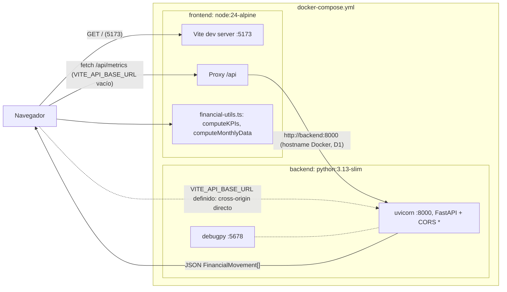
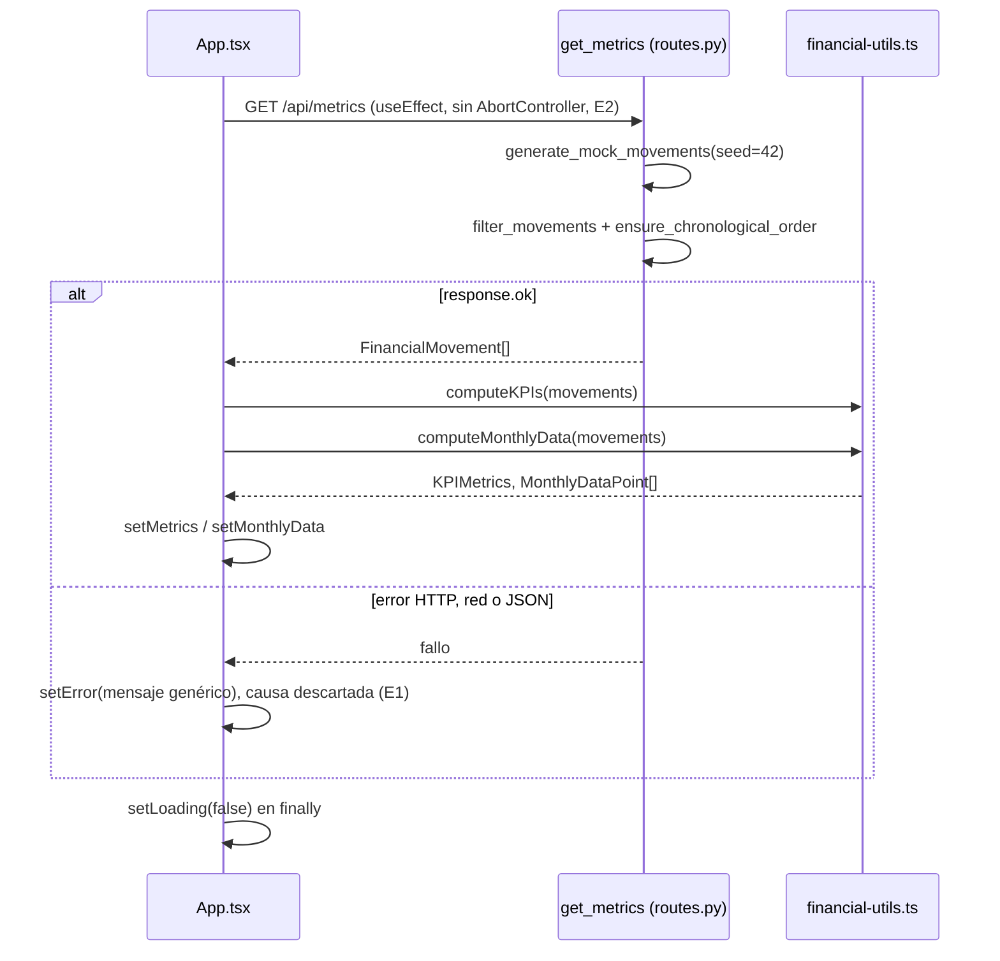
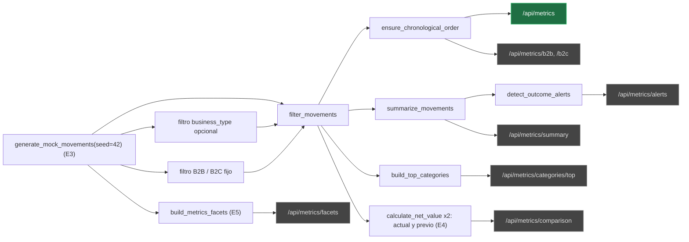
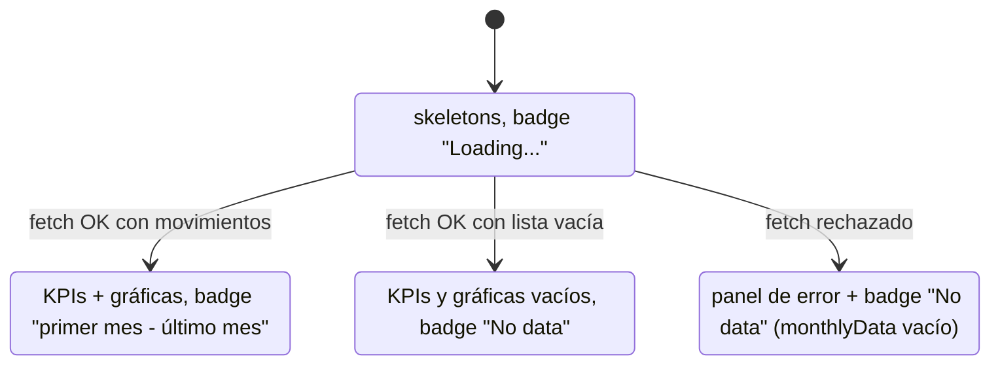
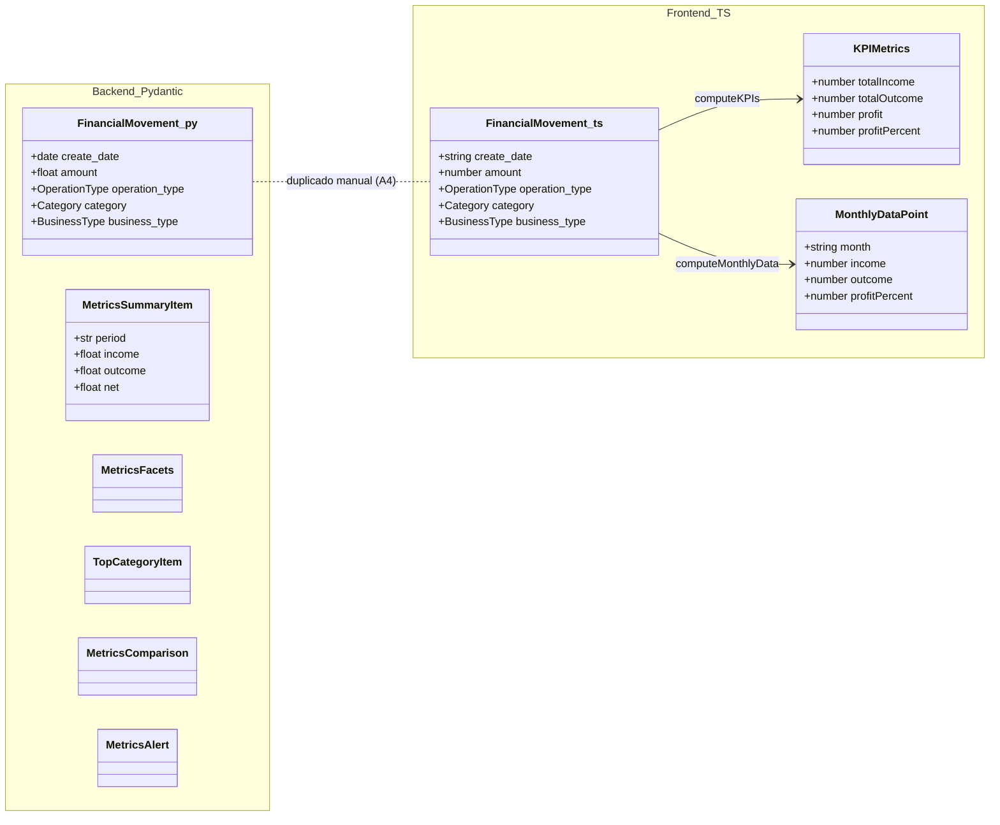

# System Patterns — Arquitectura, flujo de datos y conexión frontend-backend

> Patrones observados en el código real del repositorio. Cada afirmación cita la ruta exacta.

## 1. Arquitectura general

- **Backend**: `backend/app/main.py` (FastAPI + CORS + router) y `backend/app/routes.py` (modelos Pydantic, generador de datos, funciones de dominio y 9 endpoints).
- **Frontend**: `frontend/src/App.tsx` (composición, fetch, estados) + `financial-utils.ts` (lógica de negocio del cliente) + `components/dashboard/*` (presentación) + `components/ui/*` (primitivas shadcn) + `lib/*` (tipos, helpers).

## 2. Flujo de datos (solicitud principal)

**Una sola petición por pantalla:**

1. `App.tsx` monta y en `useEffect` llama a `fetchFinancialData()` → `fetch(\`${API_BASE_URL}/api/metrics\`)`.
2. Backend: `GET /api/metrics` → `get_metrics` (`backend/app/routes.py`) →
   - `generate_mock_movements(seed=42)`: genera **360 movimientos** (12 meses × 30) de un **año móvil** relativo a `date.today()` (`_year_for_month`, `_build_movement`).
   - Aplica filtros opcionales (`start_date`, `end_date`, `category`, `operation_type`) con `filter_movements`.
   - Devuelve `ensure_chronological_order(filtered)` como `list[FinancialMovement]`.
3. Frontend recibe el JSON y **calcula en el cliente** (`financial-utils.ts`):
   - `computeKPIs(movements)` → `KPIMetrics { totalIncome, totalOutcome, profit, profitPercent }`.
   - `computeMonthlyData(movements)` → `MonthlyDataPoint[]` agrupado por mes (`toYearMonthKey` → `YYYY-MM`), con `month` formateado `en-US` (`fmt: "short", year: "numeric"`).
4. Render: `DashboardHeader` (periodo derivado de `monthlyData[0].month` … `monthlyData[last].month`), `KPIRow` (4 KPI cards) y 2 gráficas Recharts.

## 3. Patrón de datos: generador mock determinista

- **Semilla fija `seed=42`** en los 8 endpoints `/api/metrics*` → datos reproducibles entre requests (patrón "mock determinista en memoria", `backend/app/routes.py`).
- `generate_mock_movements(seed: int | None)` muta el RNG global **solo si se pasa `seed`** (`random.seed(seed)`) — hallazgo E3 en `findings.md` (recomendación: usar `random.Random(seed)` local).
- No hay persistencia: cada request regenera la serie.

## 4. Patrón de cálculo del dominio (backend: `backend/app/routes.py`)

Funciones puras sobre `list[FinancialMovement]`:

| Función | Responsabilidad |
|---|---|
| `filter_movements_by_date` / `filter_movements` | Filtrado por fecha, categoría, operation type |
| `ensure_chronological_order` | Orden cronológico (`sorted` por `create_date`) |
| `summarize_movements` | Agregación por `day\|week\|month` (`income`, `outcome`, `net`) |
| `build_metrics_facets` | Facets de filtro + `min_date`/`max_date` (⚠️ accede a `ordered[0]`/`ordered[-1]` sin manejar listas vacías — hallazgo E5) |
| `build_top_categories` | Top N categorías por operation type |
| `calculate_net_value` | `income - outcome` (redondeado a 2 decimales) |
| `detect_outcome_alerts` | Alertas si `(outcome - baseline)/baseline > threshold` sobre media histórica |

Pipeline por endpoint (verde: consumido por la UI; gris: sin consumidor, A2):

## 5. Estructura del backend

- **Capa única**: `routes.py` concentra transporte HTTP + generación + dominio (hallazgo A1). `main.py` solo configura la app.
- **Modelos Pydantic** por respuesta: `FinancialMovement`, `MetricsFacets`, `MetricsSummaryItem`, `TopCategoryItem`, `MetricsComparison`, `MetricsAlert` (`@router.get(..., response_model=...)`).
- **Endpoints**: 1 × `GET /health` + 8 × `GET /api/metrics*` (ver tabla en `productContext.md`).

## 6. Conexión frontend-backend (proxy + CORS)

- **Proxy Vite** (`frontend/vite.config.ts`): `/api` → `http://backend:8000`, `changeOrigin: true`. Hostname **Docker**, no `localhost` (hallazgo D1).
- **`VITE_API_BASE_URL`**: override opcional vía `import.meta.env.VITE_API_BASE_URL ?? ""` (`App.tsx`). Si se define, `fetch` hace peticiones cross-origin directas (por eso el backend tiene `CORSMiddleware allow_origins=["*"]` en `main.py`).
- Variable definida en `frontend/.env.example`.

## 7. Patrón de presentación (frontend)

- **Composición**: página → sections → componentes de dashboard (`App.tsx`).
- **Presentadores**: `kpi-card.tsx`, `income-outcome-chart.tsx`, `profit-percent-chart.tsx`, `dashboard-header.tsx`.
- **Primitivas**: `components/ui/card.tsx` (Card) y `components/ui/skeleton.tsx` (Skeleton), clásico patrón shadcn/ui + helper `cn` (`lib/utils.ts` = `clsx` + `tailwind-merge`).
- **Estados de UI**: `loading` (skeletons), `error` (panel destructivo condicional), datos (`metrics`, `monthlyData`).

## 8. Contratos de datos entre lenguajes (duplicación manual)

- `FinancialMovement` está definido **dos veces**: como modelo Pydantic en `backend/app/routes.py` y como `interface` en `frontend/src/lib/financial-types.ts`. Mismos campos: `create_date`, `amount`, `operation_type`, `category`, `business_type`.
- **No se generan desde OpenAPI**: la sincronización es manual (hallazgo A4). Cualquier cambio de contrato debe actualizar ambos lados.

## 9. Estructura de pruebas

- **Backend** (`backend/tests/test_routes.py`): `TestClient(app)` con 15 tests que cubren generación (360 registros), filtros de fechas, `/health` y filtros por business type (B2B/B2C), además de contratos de endpoints.
- **Frontend** (`frontend/src/lib/financial-utils.test.ts`): 5 tests de funciones puras (`computeKPIs`, `computeMonthlyData`, formatters).
- `backend/tests/conftest.py` agrega `backend/` al `sys.path` (permite `from app.main import app`).

## 10. Convenciones detectadas y reglas asociadas

| Hallazgo (findings.md) | Regla en `.agents/rules/` |
|---|---|
| A1 router de una sola capa | `backend-conventions.md` |
| A2 UI vs endpoints analíticos | `backend-conventions.md` / `frontend-structure.md` |
| A3 periodo mostrado ≠ datos | `frontend-structure.md` (**ya corregido**: periodo derivado de `monthlyData`) |
| A4 contratos duplicados | `backend-conventions.md` / `frontend-structure.md` |
| N1 vocabulario `outcome` | `backend-conventions.md` |
| N2 locales/idiomas | `frontend-structure.md` |
| E1–E5 error handling | `backend-conventions.md` |
| T1–T3 testing | `backend-conventions.md` / `frontend-structure.md` |
| D1–D4 DX | `git-workflow.md` / `frontend-structure.md` |